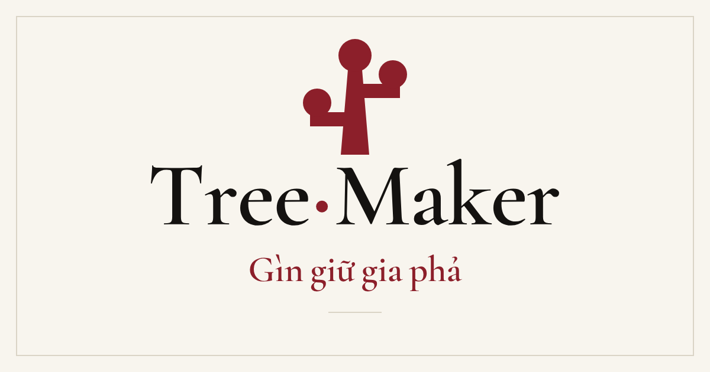

# TreeMaker _(treemaker)_

<div align="center">
  
</div>

[](https://nextjs.org/)
[](https://supabase.com/)
[](https://tailwindcss.com/)
[](https://reactflow.dev/)

Nền tảng xây dựng và lưu trữ gia phả dòng họ.

TreeMaker là ứng dụng web mã nguồn mở dùng để ghi chép, lập sơ đồ và lưu trữ gia
phả dòng họ. Ứng dụng dựng cây phả hệ tương tác trực tiếp trên canvas 2D, quản
lý hồ sơ từng thành viên và xuất toàn bộ dữ liệu ra sách kỷ yếu (LegacyBook)
dạng PDF, sẵn sàng in cho gia đình.

## Mục lục

- [Cài đặt](#cài-đặt)
- [Sử dụng](#sử-dụng)
- [Tính năng chính](#tính-năng-chính)
- [Công nghệ sử dụng](#công-nghệ-sử-dụng)
- [Cấu trúc thư mục](#cấu-trúc-thư-mục)
- [Đóng góp](#đóng-góp)
- [Giấy phép](#giấy-phép)

## Cài đặt

### Yêu cầu

- Node.js 20 trở lên
- npm, pnpm hoặc yarn
- Tài khoản [Supabase](https://supabase.com/)

### Các bước cài đặt

1. **Tải mã nguồn:**

   ```bash
   git clone https://github.com/dexter826/treemaker.git
   cd treemaker
   ```

2. **Cài đặt thư viện:**

   ```bash
   npm install
   ```

3. **Cấu hình biến môi trường:**
   Tạo tệp `.env` từ tệp mẫu:

   ```bash
   cp .env.example .env
   ```

   Cập nhật các thông tin kết nối cần thiết:

   | Biến                            | Mô tả                       |
   | ------------------------------- | --------------------------- |
   | `NEXT_PUBLIC_SUPABASE_URL`      | URL dự án trên Supabase     |
   | `NEXT_PUBLIC_SUPABASE_ANON_KEY` | Public Anon Key từ Supabase |

4. **Khởi tạo cơ sở dữ liệu:**
   Chạy lần lượt các tệp SQL trong thư mục `supabase/migrations/` trên giao diện
   SQL Editor của Supabase để tạo bảng và chính sách bảo mật RLS.

## Sử dụng

```bash
npm run dev       # Khởi chạy môi trường phát triển (mặc định tại http://localhost:3000)
npm run build     # Đóng gói sản phẩm (production build)
npm run lint      # Kiểm tra lỗi quy chuẩn code với ESLint
```

Luồng sử dụng cơ bản:

1. Đăng nhập, tạo gia phả đầu tiên.
2. Thêm thành viên và nối quan hệ (cha, mẹ, vợ/chồng, con) ngay trên canvas.
3. Chia sẻ cây qua liên kết, hoặc xuất kỷ yếu PDF để in.

## Tính năng chính

- **Canvas tương tác 2D**: Kéo thả, phóng to thu nhỏ và tự động sắp xếp sơ đồ gia
  phả bằng React Flow (`@xyflow/react`) kết hợp thuật toán Dagre.
- **Xuất kỷ yếu PDF**: Tạo và xuất dữ liệu gia phả thành sách kỷ yếu dạng PDF
  (LegacyBook) bằng jsPDF.
- **Bảo mật với Supabase RLS**: Toàn bộ dữ liệu được lưu trữ trên PostgreSQL và
  phân quyền chặt chẽ theo tài khoản qua Row Level Security.
- **Đồng bộ thời gian thực**: Cập nhật ngay các thay đổi trên sơ đồ giữa các
  thiết bị.
- **Quản lý hồ sơ thành viên**: Lưu trữ thông tin ngày sinh, ngày mất, quê quán,
  quốc gia cư trú (kèm cờ hiển thị) và ảnh chân dung (qua Supabase Storage).
- **Giao diện thích ứng**: Hiển thị mượt mà trên cả máy tính lẫn thiết bị di động.

## Công nghệ sử dụng

- **Giao diện**: Next.js 15 (App Router), React 19, Tailwind CSS 4, Motion,
  Lucide Icons, Shadcn UI.
- **Canvas & Layout**: React Flow (`@xyflow/react`), Dagre.
- **Cơ sở dữ liệu & Backend**: Supabase (PostgreSQL, Auth, Storage, Realtime).
- **Quản lý trạng thái**: Zustand, Immer.
- **Xuất tài liệu**: jsPDF.

## Cấu trúc thư mục

```text
treemaker/
├── docs/                 # Tài liệu dự án và các quyết định kiến trúc (ADR)
├── public/               # Tệp tĩnh (ảnh, biểu tượng, animation)
├── src/
│   ├── app/              # Router và các trang của Next.js (App Router)
│   ├── components/       # Component giao diện dùng chung (Shadcn UI)
│   ├── features/         # Các module nghiệp vụ chính (Deep Modules)
│   │   ├── auth/         # Đăng nhập và xác thực người dùng
│   │   ├── person/       # Quản lý thành viên, biểu mẫu và dữ liệu cá nhân
│   │   └── tree/         # Canvas gia phả, thuật toán layout và xuất PDF kỷ yếu
│   ├── hooks/            # Custom React hooks dùng chung
│   ├── lib/              # Tiện ích, store trạng thái và client Supabase
│   └── types/            # Khai báo kiểu TypeScript dùng chung
└── supabase/             # Cấu hình và các bản migration cơ sở dữ liệu
```

## Đóng góp

PR được hoan nghênh. Với thay đổi lớn, mở issue trao đổi trước khi làm. Câu hỏi
về dự án: mở issue hoặc liên hệ [@dexter826](https://github.com/dexter826).

## Giấy phép

[MIT](./LICENSE) © dexter826

<div align="center">
  Do <a href="https://github.com/dexter826">dexter826</a> phát triển dành cho gia đình.
</div>
